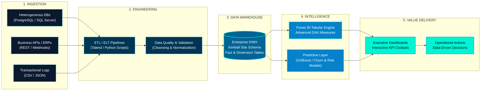

<!-- ================================================================= -->
<!--                         HERO SECTION                             -->
<!-- ================================================================= -->

<div align="center">


<br>


<br><br>

<!-- ACTION BUTTONS -->
<a href="https://www.linkedin.com/in/hazem-khaled-data" target="_blank">
  
</a>
&nbsp;&nbsp;
<a href="mailto:hazemhazem9089@gmail.com">
  
</a>
&nbsp;&nbsp;
<a href="https://github.com/hazem897?tab=repositories" target="_blank">
  
</a>

<br><br>

<!-- METRICS BADGES -->

&nbsp;

&nbsp;


</div>

<br>

---

<!-- ================================================================= -->
<!--                       EXECUTIVE DASHBOARD HUD                     -->
<!-- ================================================================= -->

<div align="center">

| 🏛️ **Domain Focus** | ⚙️ **Core Tech Stack** | 📊 **Deliverables** | 🌍 **Location** |
| :--- | :--- | :--- | :--- |
| **Enterprise BI & Analytics** | `Power BI` `DAX` `SQL` `Python` `ETL` | Executive Portals & ML Modeling | **Tunisia 🇹🇳 (Remote Ready)** |

</div>

<br>

<table>
<tr>
<td width="63%" valign="top">

### 💎 Executive Summary & Value Proposition

I am a **Data Analyst & BI Engineer** specializing in converting scattered, high-volume enterprise data into clear, reliable, and high-impact decision-support systems.

Rather than building isolated visual reports, I design the **entire data continuum**:

> 📥 **Ingestion ➔ 🧹 Automated ETL ➔ 📐 Dimensional Modeling ➔ ⚡ DAX Intelligence ➔ 🎯 Executive KPI Cockpits**

#### 🏆 What Sets My Work Apart:
- **Business-First Metric Design:** Every KPI is tied to bottom-line ROI, churn prevention, operational throughput, or risk reduction.
- **Enterprise-Grade Modeling:** Implementation of strict Kimball Star/Snowflake schemas for millisecond query performance.
- **Predictive Integration:** Seamlessly injecting ML classification algorithms (e.g., XGBoost) into daily analytical workflows.
- **Security & Scalability:** Production deployment experience with **RBAC (Role-Based Access Control)** and multi-tier access tiers.

🎓 Currently pursuing a **Professional Master’s in Information Systems & Knowledge Engineering (ISIC)**.  
💼 Former BI Intern at **Ooredoo Tunisie** (Enterprise Telecommunications).

</td>

<td width="37%" valign="top">

### ⚡ Executive Core Competencies

<br>

**Business Intelligence & Visualization**
- Advanced DAX (Time Intelligence, Iterators, Calc Groups)
- Tabular Modeling & Performance Tuning
- Executive UI/UX Design & Data Storytelling

**Data Architecture & Engineering**
- Kimball Dimensional Modeling (Star / Snowflake)
- Automated ETL / ELT Workflows (`Talend`, `Python`)
- Enterprise RDBMS: `PostgreSQL`, `SQL Server`, `MySQL`

**Analytical & Predictive Computing**
- Advanced SQL (Window Functions, CTEs, Aggregations)
- Python for Analytics (`Pandas`, `NumPy`, `Seaborn`)
- Applied Machine Learning (`XGBoost`, `Scikit-learn`)

**Full-Stack & Security Integration**
- Full-Stack Dashboards (`React`, `Node.js`, `Angular`)
- Enterprise Security: `RBAC`, `2FA`, Data Governance

</td>
</tr>
</table>

---

<!-- ================================================================= -->
<!--                   ENTERPRISE DATA PIPELINE FLOW                   -->
<!-- ================================================================= -->

## 🔄 Enterprise Data Architecture Flow



---

<!-- ================================================================= -->
<!--                        TECHNICAL ARSENAL                          -->
<!-- ================================================================= -->

## 🛠️ Technology Matrix & Tooling

<div align="center">

<table>
<tr>
  <td align="center" width="25%"><b>BI & Analytics</b></td>
  <td align="center" width="25%"><b>Data Engineering</b></td>
  <td align="center" width="25%"><b>Databases & DWH</b></td>
  <td align="center" width="25%"><b>App Dev & DevOps</b></td>
</tr>
<tr>
  <td align="center">
    <br><br>
    <br>
    <br>
    <br>
    
  </td>
  <td align="center">
    <br><br>
    <br>
    <br>
    <br>
    
  </td>
  <td align="center">
    <br><br>
    <br>
    <br>
    <br>
    
  </td>
  <td align="center">
    <br><br>
    <br>
    <br>
    <br>
    
  </td>
</tr>
</table>

</div>

---

<!-- ================================================================= -->
<!--                      FLAGSHIP CASE STUDIES                        -->
<!-- ================================================================= -->

## 🚀 Strategic Projects & Case Studies

<p align="center"><i>Each project addresses a real-world business challenge with measurable KPIs and end-to-end technical implementation.</i></p>

<table>

<!-- TELECOM CHURN CASE -->
<tr>
<td width="72%" valign="top">

### 📡 01. Telecom Customer Churn & Retention Intelligence
**Executive Retention & Lifetime Value System**

- 🎯 **Business Problem:** Telecommunications operators face high churn rates among monthly contract subscribers, causing severe revenue leakages.
- 💡 **Solution:** Engineered a comprehensive Power BI retention cockpit modeling subscriber cohorts, risk velocity curves, and service bundle correlations.
- 📈 **Key Analytical Metrics:** Churn Rate by Contract, Customer Lifetime Value (CLV), Monthly Recurring Revenue (MRR) at risk, Tenure Segmentations.
- 🧰 **Tech Stack:** `Power BI` `Advanced DAX` `Star Schema Data Modeling` `ETL Pipeline`

</td>
<td width="28%" align="center" valign="middle">


<br><br>

<br><br>
<a href="https://github.com/hazem897/Telecom-Customer-Churn-Analytics" target="_blank">
  
</a>

</td>
</tr>

<!-- BANKING FRAUD CASE -->
<tr>
<td width="72%" valign="top">

### 🏦 02. Banking Customer Analytics & Anti-Fraud Security Portal
**High-Security Financial Telemetry & Anomaly Detection**

- 🎯 **Business Problem:** Identifying suspicious transactions across high-frequency merchant endpoints while preventing legitimate customer friction.
- 💡 **Solution:** Built an integrated platform combining operational banking telemetry, transaction fraud scoring, and strict security governance.
- 📈 **Key Analytical Metrics:** Anomaly Velocity Index, Merchant Fraud Ratios, Geographic Inconsistencies, False-Positive Mitigation.
- 🧰 **Tech Stack:** `Angular` `Node.js` `PostgreSQL` `Power BI Embedded` `RBAC + 2FA`

</td>
<td width="28%" align="center" valign="middle">


<br><br>

<br><br>
<a href="https://github.com/hazem897/Banking-Customer-Analytics-Fraud-Detection" target="_blank">
  
</a>

</td>
</tr>

<!-- SMART MOBILITY -->
<tr>
<td width="72%" valign="top">

### 🚗 03. Smart Mobility & Traffic Congestion Intelligence
**Metropolitan Traffic Flow & Infrastructure Planning**

- 🎯 **Business Problem:** Optimizing urban transit infrastructure by uncovering systemic congestion bottlenecks across Tunisian governorates.
- 💡 **Solution:** Cleaned and transformed high-volume mobility logs via Python; built interactive GIS heatmaps and temporal bottleneck tracking in Power BI.
- 📈 **Key Analytical Metrics:** Peak-Hour Delta, Congestion Duration Indices, Fleet Delay Factors, Spatial Density.
- 🧰 **Tech Stack:** `Python (Pandas / GeoPy)` `Power BI` `DAX` `Geospatial Modeling`

</td>
<td width="28%" align="center" valign="middle">


<br><br>

<br><br>


</td>
</tr>

<!-- SUPPLY CHAIN -->
<tr>
<td width="72%" valign="top">

### 📦 04. Supply Chain & Logistics Throughput Optimizer
**Multi-Echelon Operational Visibility**

- 🎯 **Business Problem:** Fragmented data between procurement, multi-warehouse stock levels, and carrier shipping lead times causing delivery penalties.
- 💡 **Solution:** Built a consolidated dimensional data model linking warehouse capacity, inventory velocity, and shipping reliability metrics.
- 📈 **Key Analytical Metrics:** On-Time In-Full (OTIF), Days Sales of Inventory (DSI), Carrier Delay Variance, Stockout Rate.
- 🧰 **Tech Stack:** `Python` `SQL` `Power BI` `Enterprise Star Schema`

</td>
<td width="28%" align="center" valign="middle">


<br><br>

<br><br>


</td>
</tr>

<!-- HR ANALYTICS -->
<tr>
<td width="72%" valign="top">

### 👥 05. HR Workforce Analytics & Attrition Early-Warning
**Human Capital Intelligence & Retention Forecasting**

- 🎯 **Business Problem:** High turnover in critical business units without visibility into compensation disparities or engagement drops.
- 💡 **Solution:** Delivered an executive workforce dashboard segmenting flight risk, attrition indicators, and performance correlations.
- 📈 **Key Analytical Metrics:** Voluntary vs. Involuntary Turnover, Compa-Ratio vs. Performance, Departmental Attrition Index.
- 🧰 **Tech Stack:** `Power BI` `DAX Patterns` `HR Fact Tables`

</td>
<td width="28%" align="center" valign="middle">


<br><br>

<br><br>


</td>
</tr>

</table>

---

<!-- ================================================================= -->
<!--                    PROFESSIONAL TRACK RECORD                      -->
<!-- ================================================================= -->

## 💼 Professional Experience & Education

```text
┌────────────────────────────────────────────────────────────────────────────────────────┐
│ 🔴 BUSINESS INTELLIGENCE INTERN • OOREDOO TUNISIE                                       │
│    Telecom Decision Support & Analytics Portal                                         │
├────────────────────────────────────────────────────────────────────────────────────────┤
│ • Architected a secure decision-support portal integrating BI with machine learning.   │
│ • Engineered scalable Talend ETL workflows consolidating multi-source telecom data.    │
│ • Deployed PostgreSQL data warehouse tables following Kimball dimensional principles. │
│ • Designed executive Power BI dashboards with drill-through analytics & strict RBAC.   │
│ • Implemented XGBoost predictive models for telecom customer behavior analytics.       │
│                                                                                        │
│ Tech: Power BI, Talend, PostgreSQL, Python, XGBoost, React, Node.js                    │
└────────────────────────────────────────────────────────────────────────────────────────┘

┌────────────────────────────────────────────────────────────────────────────────────────┐
│ 🎓 EDUCATION & ACADEMIC CREDENTIALS                                                   │
├────────────────────────────────────────────────────────────────────────────────────────┤
│ • Professional Master's: Information Systems & Knowledge Engineering (ISIC)            │
│   Faculty of Economic Sciences and Management of Nabeul (FSEGN)                        │
│                                                                                        │
│ • Bachelor's Degree: Management Information Systems — Business Intelligence (2023-2026)│
│   Faculty of Economic Sciences and Management of Nabeul (FSEGN)                        │
└────────────────────────────────────────────────────────────────────────────────────────┘
```

---

<!-- ================================================================= -->
<!--                       GITHUB LIVE ANALYTICS                       -->
<!-- ================================================================= -->

## 📈 Real-Time Engineering Telemetry

<div align="center">


&nbsp;


<br><br>


<br><br>


</div>

---

<!-- ================================================================= -->
<!--                          CALL TO ACTION                           -->
<!-- ================================================================= -->

<div align="center">

## 🤝 Let's Build Impactful Data Solutions Together

I am open to **Senior / Lead Data Analyst & BI Engineering** opportunities, high-value consulting, and data pipeline collaborations.

<br>

<a href="https://www.linkedin.com/in/hazem-khaled-data" target="_blank">
  
</a>
&nbsp;&nbsp;
<a href="mailto:hazemhazem9089@gmail.com">
  
</a>

<br><br>

<sub>Designed with precision & engineered for business value • © Hazem Khaled</sub>

<br>


</div>
