<!-- ========================================================= -->
<!--                        HERO SECTION                       -->
<!-- ========================================================= -->

 

  

<!-- PRIMARY ACTION BUTTONS -->

&nbsp;

&nbsp;

  

 

---

<!-- ========================================================= -->
<!--                    MY PORTFOLIO SHOWCASE                  -->
<!-- ========================================================= -->

## 🌐 My Portfolio Website

> **Explore my live interactive portfolio featuring interactive video demonstrations, end-to-end case studies, and multilingual access (EN / FR / AR):**
> 
> 👉 **[hazem-khaled-portfolio.vercel.app](https://hazem-khaled-portfolio.vercel.app/)** 👈

 

 

---

<!-- ========================================================= -->
<!--                      ABOUT ME                             -->
<!-- ========================================================= -->

## 👋 About Me

I am a **Data Analyst and Business Intelligence Developer** based in **Tunisia**, open to on-site and **international remote opportunities**.

I specialize in the end-to-end analytics workflow: extracting data from relational databases, designing automated **ETL/ELT data pipelines**, building structured **analytical data models**, and delivering intuitive **Power BI dashboards** for decision-makers.

My project experience spans key domains such as **Telecommunications, Banking & Fraud Analytics, Retail Sales & Inventory, Weather Intelligence, and HR Analytics**.

- 🎯 **Primary Focus:** Business Intelligence (Power BI & DAX), SQL analytics, ETL automation (Talend & Python), and dimensional modeling.
- 💼 **Experience:** Business Intelligence Intern at **Ooredoo Tunisie** (telecom data pipelines, predictive models, and secure BI portals).
- 🎓 **Education:** Currently pursuing a **Mastère Professionnel en Informatique (ISIC)** at FSEGN Nabeul.

---

<!-- ========================================================= -->
<!--                    ANALYTICS WORKFLOW                     -->
<!-- ========================================================= -->

## 🔄 How I Work With Data

```mermaid
flowchart LR
    A["Raw Data Sources<br/>(PostgreSQL / SQL Server / APIs / CSV)"] --> B["Data Integration & ETL<br/>(Talend / Python / Cleaning)"]
    B --> C["Data Modeling<br/>(Star Schema / Relationships)"]
    C --> D["Analysis & KPIs<br/>(SQL / Pandas / DAX Measures)"]
    D --> E["BI Dashboards<br/>(Power BI Visual Storytelling)"]
    E --> F["Decision Support<br/>(Actionable Business Insights)"]

    style A fill:#071A2E,stroke:#00B4D8,stroke-width:1px,color:#fff
    style B fill:#0B3D66,stroke:#00B4D8,stroke-width:1px,color:#fff
    style C fill:#126782,stroke:#00E5FF,stroke-width:1px,color:#fff
    style D fill:#168AAD,stroke:#00E5FF,stroke-width:1px,color:#fff
    style E fill:#00A6C7,stroke:#00E5FF,stroke-width:1px,color:#000
    style F fill:#00E5FF,stroke:#00B4D8,stroke-width:2px,color:#050B14
```

---

<!-- ========================================================= -->
<!--                    TECHNICAL SKILLS                       -->
<!-- ========================================================= -->

## 🛠️ Technical Skills

<table>
<tr>
  <td width="50%" valign="top">

### 📊 Business Intelligence & Analytics
- **Tools:** Power BI, DAX, Power Query (M), Data Visualization
- **Core Strengths:** Star Schema Modeling, Time Intelligence, Custom KPIs, Drill-Through Reports, Dashboard UI Design

 

### 🔍 Data Analysis & Computation
- **Languages:** SQL, Python
- **Libraries:** Pandas, NumPy, Matplotlib, Seaborn
- **Techniques:** Exploratory Data Analysis (EDA), Cohort Analysis, Statistical Summaries, Data Cleaning

  </td>
  <td width="50%" valign="top">

### ⚙️ Data Engineering & ETL
- **Integration Tools:** Talend Open Studio
- **Workflows:** ETL / ELT pipeline design, Data Cleansing, Data Transformation, Automated File Ingestion

 

### 🗄️ Relational Databases & Storage
- **Databases:** PostgreSQL, MySQL, Microsoft SQL Server
- **Database Skills:** Complex Queries, Joins, Window Functions, Aggregate Queries, Schema Design

 

### 💻 Development & Version Control
- **Web & Backend:** React, Node.js, Angular, Java, PHP *(explored through project integration)*
- **Tools:** Git, GitHub, VS Code

  </td>
</tr>
</table>

---

<!-- ========================================================= -->
<!--                   FEATURED PROJECTS                       -->
<!-- ========================================================= -->

## 🚀 Featured Projects

A curated selection of decision-support and data analytics projects built across various business domains.

 

<!-- PROJECT 1: TELECOM CHURN -->
<table>
<tr>
<td width="72%" valign="top">

### 📡 [Telecom Customer Churn Analytics](https://github.com/hazem897/Telecom-Customer-Churn-Analytics)
**Customer Retention & Attrition Analysis**

- **Business Problem:** Telecom operators face customer turnover that erodes monthly revenue. Identifying why subscribers leave and which customer cohorts are most vulnerable is essential for targeted retention campaigns.
- **Implemented Solution:** Developed a structured Power BI reporting solution that segments customer demographics, service contract terms, and usage patterns to pinpoint specific churn risk factors.
- **Key Features:** Contract-type churn analysis, payment method risk comparison, tenure group distributions, customer segment filters, and actionable retention KPIs.
- **Tech Stack:** `Power BI` `DAX` `Data Modeling` `Data Cleaning` `CSV`

</td>
<td width="28%" align="center" valign="middle">

  

  

</td>
</tr>

<!-- PROJECT 2: BANKING & FRAUD -->
<tr>
<td width="72%" valign="top">

### 🏦 [Banking Customer Analytics & Fraud Detection](https://github.com/hazem897/Banking-Customer-Analytics-Fraud-Detection)
**Financial Intelligence & Anomaly Monitoring Platform**

- **Business Problem:** Financial institutions need unified monitoring systems to supervise transactions, track suspicious activity across merchants, and minimize financial exposure without compromising user security.
- **Implemented Solution:** Engineered a full-stack analytical platform combining operational transaction reporting with role-based access control (RBAC) and two-factor authentication (2FA) for secure management review.
- **Key Features:** Customer account profiling, transaction volume trends, suspicious activity flag monitoring, merchant categories breakdown, and interactive security controls.
- **Tech Stack:** `Angular` `Node.js` `PostgreSQL` `SQL` `Power BI` `RBAC / 2FA`

</td>
<td width="28%" align="center" valign="middle">

  

  

</td>
</tr>

<!-- PROJECT 3: RETAIL SALES -->
<tr>
<td width="72%" valign="top">

### 🛒 [Retail Sales & Inventory Analytics](https://github.com/hazem897/Retail-Sales-Inventory-Analytics)
**Commercial Performance & Stock Level Monitoring**

- **Business Problem:** Retail managers struggle with balancing inventory holding costs and avoiding stockouts across multiple product categories and sales periods.
- **Implemented Solution:** Built an analytics dashboard tracking revenue performance, order trends, product margin contributions, and warehouse inventory movements.
- **Key Features:** Sales trends over time, category-level revenue contributions, stock availability status, reorder point indicators, and store performance breakdowns.
- **Tech Stack:** `Power BI` `DAX` `Python` `SQL` `Data Modeling`

</td>
<td width="28%" align="center" valign="middle">

  

  

</td>
</tr>

<!-- PROJECT 4: WEATHER MONITORING -->
<tr>
<td width="72%" valign="top">

### 🌦️ [Weather Analytics & Monitoring Dashboard](https://github.com/hazem897/Weather-Analytics-Monitoring-Dashboard)
**Meteorological Trends & Regional Climate Comparison**

- **Business Problem:** Meteorological and environmental datasets require structured cleaning and visual consolidation to analyze weather variances across cities and evaluate historical trends.
- **Implemented Solution:** Designed a data pipeline in Python to ingest, clean, and format weather observations, followed by an interactive dashboard enabling spatial and temporal comparisons across Tunisian cities.
- **Key Features:** Temperature trends, precipitation tracking, comparative city climate metrics, seasonal variations, and key environmental indicators.
- **Tech Stack:** `Python` `Pandas` `Power BI` `Data Modeling` `Data Cleaning`

</td>
<td width="28%" align="center" valign="middle">

  

  

</td>
</tr>

<!-- PROJECT 5: HR ATTRITION -->
<tr>
<td width="72%" valign="top">

### 👥 [HR Analytics & Employee Attrition Intelligence](https://github.com/hazem897/HR-Analytics-Employee-Attrition-Intelligence)
**Workforce Demographics & Attrition Factors**

- **Business Problem:** Unplanned employee turnover disrupts organizational performance. Human Resources teams need visibility into which departments, tenure levels, and compensation tiers exhibit higher attrition rates.
- **Implemented Solution:** Constructed an analytical dashboard exploring HR metrics to identify demographic patterns, salary-to-role relationships, and tenure factors associated with employee departures.
- **Key Features:** Departmental turnover rates, job satisfaction vs. attrition comparison, compensation equity breakdown, tenure distribution, and workforce headcounts.
- **Tech Stack:** `Power BI` `DAX` `Data Modeling` `HR Fact Tables`

</td>
<td width="28%" align="center" valign="middle">

  

  

</td>
</tr>
</table>

---

<!-- ========================================================= -->
<!--                    PROFESSIONAL EXPERIENCE                -->
<!-- ========================================================= -->

## 💼 Professional Experience

### 🔴 Business Intelligence Intern — Ooredoo Tunisie
*Internship | Telecommunications Analytics*

Contributed to the development of a secure decision-support web portal integrating Business Intelligence workflows, data engineering, and predictive modeling:

- **Data Integration & ETL:** Designed automated ETL jobs using **Talend Open Studio** to extract, cleanse, and load telecom operational data into a **PostgreSQL** database.
- **Data Modeling & Storage:** Structured analytical tables and relationships within PostgreSQL to optimize query times for reporting.
- **Power BI Dashboards:** Built interactive dashboards focusing on customer indicators, usage patterns, and operational performance metrics for internal stakeholders.
- **Predictive Analytics:** Applied **Python** and the **XGBoost** library to train and evaluate predictive models identifying customer behavior patterns and potential churn indicators.
- **Decision Portal Integration:** Assisted in integrating analytical views into a web-based portal developed with **React** and **Node.js**, respecting security and role-based access requirements.

**Technologies Used:** `Power BI` · `Talend` · `PostgreSQL` · `Python` · `XGBoost` · `React` · `Node.js` · `SQL`

---

<!-- ========================================================= -->
<!--                        EDUCATION                          -->
<!-- ========================================================= -->

## 🎓 Education

### Mastère Professionnel en Informatique
**Ingénierie des Systèmes d’Information et des Connaissances (ISIC)**  
Faculté des Sciences Économiques et de Gestion de Nabeul (FSEGN)  
*Current*

---

### Licence en Informatique de Gestion
**Spécialité : Business Intelligence**  
Faculté des Sciences Économiques et de Gestion de Nabeul (FSEGN)  
`2023 — 2026`

---

<!-- ========================================================= -->
<!--                    GITHUB ANALYTICS                       -->
<!-- ========================================================= -->

## 📈 GitHub Activity & Statistics

&nbsp;

  

  

---

<!-- ========================================================= -->
<!--                        CONTACT                            -->
<!-- ========================================================= -->

## 🤝 Let's Connect

I am actively open to discussing **Data Analyst**, **Business Intelligence Developer**, and **Power BI / Analytics** roles.

 

&nbsp;&nbsp;&nbsp;

&nbsp;&nbsp;&nbsp;

&nbsp;&nbsp;&nbsp;

  

Hazem Khaled • Data Analyst & Business Intelligence Developer

 

