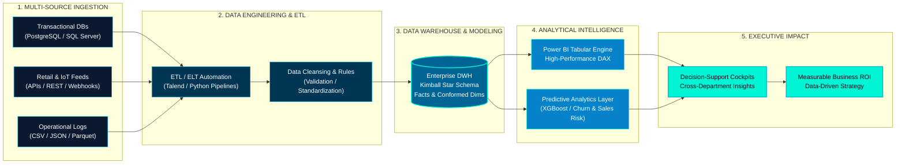

<!-- ================================================================= -->
<!--                         HERO SECTION (ANIMATED)                   -->
<!-- ================================================================= -->

<div align="center">

<!-- ANIMATED DYNAMIC TOP WAVE WITH GRADIENT -->


<br>

<!-- SMOOTH TYPING ANIMATION (3 LOOPS WITH CYBER GLOW) -->


<br><br>

<!-- INTERACTIVE CALL-TO-ACTION BUTTONS (ANIMATED HOVER EFFECT) -->
<a href="https://www.linkedin.com/in/hazem-khaled-data" target="_blank">
  
</a>
&nbsp;&nbsp;&nbsp;
<a href="mailto:hazemhazem9089@gmail.com">
  
</a>
&nbsp;&nbsp;&nbsp;
<a href="https://github.com/hazem897?tab=repositories" target="_blank">
  
</a>

<br><br>

<!-- REAL-TIME STATUS BADGES -->

&nbsp;

&nbsp;


</div>

<br>

---

<!-- ================================================================= -->
<!--                       EXECUTIVE DASHBOARD HUD                     -->
<!-- ================================================================= -->

<div align="center">

| 🏛️ **Domain Specializations** | ⚙️ **Core Tech Arsenal** | 📊 **Deliverables & Solutions** | 🌍 **Location** |
| :--- | :--- | :--- | :--- |
| **Enterprise BI & Decision Support** | `Power BI` `DAX` `SQL` `Python` `Talend` | Executive Cockpits & DWH Architectures | **Tunisia 🇹🇳 (Global Remote Ready)** |

</div>

<br>

<table>
<tr>
<td width="64%" valign="top">

### 💡 Executive Profile & Strategic Impact

I am a **Data Analyst & BI Engineer** specialized in translating sprawling, high-dimensional transactional datasets into reliable, executive-ready analytical intelligence.

Rather than building isolated surface-level charts, I engineer the **full data continuum**:

> 📥 **Ingestion ➔ 🧹 Automated ETL ➔ 📐 Kimball Star Schemas ➔ ⚡ DAX Intelligence ➔ 🎯 Executive KPI Dashboards**

#### 🏆 What Makes My Work Unique:
- **Business-First Metric Modeling:** Every measure directly maps to churn mitigation, revenue growth, inventory health, or operational throughput.
- **Enterprise-Scale DWH Design:** Strict Kimball Star & Snowflake schemas optimized for sub-second aggregations on millions of rows.
- **Machine Learning Integration:** Infusing predictive capabilities (e.g., XGBoost risk scoring) into production analytical dashboards.
- **Security & Multi-Tenancy:** Production background building secure portals with **Role-Based Access Control (RBAC)** and 2FA.

🎓 Pursuing a **Professional Master’s in Information Systems & Knowledge Engineering (ISIC)**.  
💼 Former BI Intern at **Ooredoo Tunisie** (Enterprise Telecommunications).

</td>

<td width="36%" valign="top">

### ⚡ Technical Competency Matrix

<br>

**Business Intelligence & Visualization**
- Advanced DAX (Time Intelligence, Iterators, Calc Groups)
- Tabular Modeling, Performance Analyzer & VertiPaq
- Executive UI/UX Design & Human-Centered Storytelling

**Data Architecture & Engineering**
- Kimball Dimensional Modeling (Star / Snowflake)
- Automated ETL / ELT Workflows (`Talend`, `Python`)
- Enterprise RDBMS: `PostgreSQL`, `SQL Server`, `MySQL`

**Analytical & Predictive Computing**
- Advanced SQL (Window Functions, CTEs, Aggregations)
- Python for Analytics (`Pandas`, `NumPy`, `Seaborn`)
- Applied Machine Learning (`XGBoost`, `Scikit-learn`)

**Full-Stack & Governance Integration**
- Web Portals (`React`, `Node.js`, `Angular`)
- Data Governance, RBAC Security, Audit Trails

</td>
</tr>
</table>

---

<!-- ================================================================= -->
<!--                   ENTERPRISE DATA PIPELINE FLOW                   -->
<!-- ================================================================= -->

## 🔄 End-to-End Enterprise Data Architecture Flow



---

<!-- ================================================================= -->
<!--                        TECHNICAL ARSENAL                          -->
<!-- ================================================================= -->

## 🛠️ Technology Stack & Tooling

<div align="center">

<table>
<tr>
  <td align="center" width="25%"><b>BI & Visualization</b></td>
  <td align="center" width="25%"><b>Data Engineering & ML</b></td>
  <td align="center" width="25%"><b>Databases & DWH</b></td>
  <td align="center" width="25%"><b>Full-Stack & DevOps</b></td>
</tr>
<tr>
  <td align="center">
    <br><br>
    <br>
    <br>
    <br>
    
  </td>
  <td align="center">
    <br><br>
    <br>
    <br>
    <br>
    
  </td>
  <td align="center">
    <br><br>
    <br>
    <br>
    <br>
    
  </td>
  <td align="center">
    <br><br>
    <br>
    <br>
    <br>
    
  </td>
</tr>
</table>

</div>

---

<!-- ================================================================= -->
<!--                      FLAGSHIP CASE STUDIES                        -->
<!-- ================================================================= -->

## 🚀 Strategic Projects & Case Studies

<p align="center"><i>End-to-end architectures addressing mission-critical business problems with measurable KPIs.</i></p>

<table>

<!-- TELECOM CHURN CASE -->
<tr>
<td width="72%" valign="top">

### 📡 01. [Telecom Customer Churn & Retention Analytics](https://github.com/hazem897/Telecom-Customer-Churn-Analytics)
**Executive Retention & Revenue Risk Intelligence**

- 🎯 **Business Problem:** High subscriber churn causing heavy recurring revenue attrition and inflated customer acquisition costs (CAC).
- 💡 **Solution:** Built an end-to-end Power BI solution modeling customer cohorts, contract tenure risk distributions, and bundle churn correlations.
- 📈 **Key Analytical Metrics:** Churn Rate by Contract, Customer Lifetime Value (CLV), Monthly Recurring Revenue (MRR) at risk, Tenure Hazard.
- 🧰 **Tech Stack:** `Power BI` `Advanced DAX` `Star Schema Data Modeling` `ETL Pipeline`

</td>
<td width="28%" align="center" valign="middle">


<br><br>

<br><br>
<a href="https://github.com/hazem897/Telecom-Customer-Churn-Analytics" target="_blank">
  
</a>

</td>
</tr>

<!-- BANKING FRAUD CASE -->
<tr>
<td width="72%" valign="top">

### 🏦 02. [Banking Customer Analytics & Anti-Fraud Security Portal](https://github.com/hazem897/Banking-Customer-Analytics-Fraud-Detection)
**High-Security Financial Intelligence & Anomaly Scoring**

- 🎯 **Business Problem:** Rapid identification of unauthorized financial transactions across merchant terminals while reducing customer friction.
- 💡 **Solution:** Engineered a full-stack intelligence platform integrating live transaction telemetry, automated fraud flags, and security controls.
- 📈 **Key Analytical Metrics:** Anomaly Velocity Score, High-Risk Merchant Proportions, Geographic Deviation Flags, False-Positive Reductions.
- 🧰 **Tech Stack:** `Angular` `Node.js` `PostgreSQL` `Power BI Embedded` `RBAC + 2FA`

</td>
<td width="28%" align="center" valign="middle">


<br><br>

<br><br>
<a href="https://github.com/hazem897/Banking-Customer-Analytics-Fraud-Detection" target="_blank">
  
</a>

</td>
</tr>

<!-- RETAIL SALES INVENTORY (NEW) -->
<tr>
<td width="72%" valign="top">

### 🛒 03. [Retail Sales & Inventory Analytics](https://github.com/hazem897/Retail-Sales-Inventory-Analytics)
**Omnichannel Commercial Intelligence & Inventory Health Optimization**

- 🎯 **Business Problem:** Mismatches between demand spikes and warehouse stock levels resulting in stockouts, excess holding costs, and margin degradation.
- 💡 **Solution:** Designed a multi-tier analytical dashboard combining retail transaction analysis, stock turnover indicators, and product performance matrices.
- 📈 **Key Analytical Metrics:** Gross Margin Return on Investment (GMROI), Sell-Through Rate, Stockout Frequency, Revenue per Category.
- 🧰 **Tech Stack:** `Power BI` `DAX` `Python` `SQL` `Dimensional Data Modeling`

</td>
<td width="28%" align="center" valign="middle">


<br><br>

<br><br>
<a href="https://github.com/hazem897/Retail-Sales-Inventory-Analytics" target="_blank">
  
</a>

</td>
</tr>

<!-- WEATHER ANALYTICS & MONITORING (NEW) -->
<tr>
<td width="72%" valign="top">

### 🌦️ 04. Weather Analytics & Monitoring Dashboard
**Climatic Intelligence, Historical Trends & Predictive Environmental Insights**

- 🎯 **Business Problem:** Correlating meteorological variables (precipitation, humidity, air quality) to anticipate weather impact on local sectors.
- 💡 **Solution:** Pipeline ingesting historical data and forecast feeds into a high-visibility interactive monitoring system with dynamic comparative maps.
- 📈 **Key Analytical Metrics:** Variance vs. Historical Norms, Precipitation Severity Index, Microclimate Trends, Air Quality Indicators.
- 🧰 **Tech Stack:** `Python` `Power BI` `Data Cleansing` `Geographical Analytics`

</td>
<td width="28%" align="center" valign="middle">


<br><br>

<br><br>


</td>
</tr>

<!-- HR ANALYTICS -->
<tr>
<td width="72%" valign="top">

### 👥 05. HR Workforce Analytics & Attrition Early-Warning
**Human Capital Intelligence & Predictive Flight-Risk Modeling**

- 🎯 **Business Problem:** High unplanned turnover among key personnel with insufficient visibility into compensation equity and career stagnation.
- 💡 **Solution:** Built an executive HR dashboard providing early attrition warnings, employee satisfaction correlation, and demographic diversity analytics.
- 📈 **Key Analytical Metrics:** Voluntary Attrition Rate, Compa-Ratio Parity, Performance vs. Flight Risk, Tenure Retention Curves.
- 🧰 **Tech Stack:** `Power BI` `DAX Patterns` `HR Fact Tables` `Data Modeling`

</td>
<td width="28%" align="center" valign="middle">


<br><br>

<br><br>


</td>
</tr>

</table>

---

<!-- ================================================================= -->
<!--                    PROFESSIONAL TRACK RECORD                      -->
<!-- ================================================================= -->

## 💼 Professional Experience & Education

```text
┌────────────────────────────────────────────────────────────────────────────────────────┐
│ 🔴 BUSINESS INTELLIGENCE INTERN • OOREDOO TUNISIE                                       │
│    Decision Support Portal & Predictive Telecommunications Systems                     │
├────────────────────────────────────────────────────────────────────────────────────────┤
│ • Architected a secure decision-support portal integrating BI with machine learning.   │
│ • Engineered scalable Talend ETL workflows consolidating multi-source telecom data.    │
│ • Deployed PostgreSQL data warehouse tables following Kimball dimensional principles. │
│ • Designed executive Power BI dashboards with drill-through analytics & strict RBAC.   │
│ • Implemented XGBoost predictive models for telecom customer behavior analytics.       │
│                                                                                        │
│ Tech: Power BI, Talend, PostgreSQL, Python, XGBoost, React, Node.js                    │
└────────────────────────────────────────────────────────────────────────────────────────┘

┌────────────────────────────────────────────────────────────────────────────────────────┐
│ 🎓 EDUCATION & ACADEMIC CREDENTIALS                                                   │
├────────────────────────────────────────────────────────────────────────────────────────┤
│ • Professional Master's: Information Systems & Knowledge Engineering (ISIC)            │
│   Faculty of Economic Sciences and Management of Nabeul (FSEGN)                        │
│                                                                                        │
│ • Bachelor's Degree: Management Information Systems — Business Intelligence (2023-2026)│
│   Faculty of Economic Sciences and Management of Nabeul (FSEGN)                        │
└────────────────────────────────────────────────────────────────────────────────────────┘
```

---

<!-- ================================================================= -->
<!--                       GITHUB LIVE ANALYTICS (ANIMATED)            -->
<!-- ================================================================= -->

## 📈 Real-Time Engineering Telemetry

<div align="center">


&nbsp;&nbsp;


<br><br>


<br><br>


</div>

---

<!-- ================================================================= -->
<!--                          CALL TO ACTION                           -->
<!-- ================================================================= -->

<div align="center">

## 🤝 Let's Architect High-Value Data Solutions Together

I am open to **Senior / Lead Data Analyst & BI Engineering** opportunities, high-impact consulting, and end-to-end data pipeline deployments.

<br>

<a href="https://www.linkedin.com/in/hazem-khaled-data" target="_blank">
  
</a>
&nbsp;&nbsp;&nbsp;
<a href="mailto:hazemhazem9089@gmail.com">
  
</a>

<br><br>

<sub>Designed with precision & engineered for business value • © Hazem Khaled</sub>

<br>


</div>
