<!-- ========================================================= -->
<!--                        HERO SECTION                       -->
<!-- ========================================================= -->

 

  

&nbsp;

&nbsp;

  

 

---

<!-- ========================================================= -->
<!--                    MY PORTFOLIO SHOWCASE                  -->
<!-- ========================================================= -->

## 🌐 Portfolio Website

> **View my online portfolio with video walkthroughs, case studies, and multilingual support (EN / FR / AR):**
> 
> 👉 **[hazem-khaled-portfolio.vercel.app](https://hazem-khaled-portfolio.vercel.app/)** 👈

 

 

---

<!-- ========================================================= -->
<!--                      ABOUT ME                             -->
<!-- ========================================================= -->

## 👋 About Me

I am a **Data Analyst and Business Intelligence Developer** based in **Tunisia**, open to local and **international remote opportunities**.

I work across the data lifecycle: extracting data from databases, preparing and cleaning datasets with SQL and Python, creating ETL pipelines, building dimensional models, and designing interactive Power BI dashboards that help teams make informed decisions.

My work includes projects in **Telecommunications, Banking Analytics, Retail & Inventory, Weather Monitoring, and Human Resources**.

- 🎯 **Core Focus:** Power BI, DAX, SQL analytics, Python data processing, and dimensional data modeling.
- 💼 **Professional Experience:** Business Intelligence Intern at **Ooredoo Tunisie**.
- 🎓 **Current Studies:** Master's student in Information Systems and Knowledge Engineering (ISIC) at FSEGN Nabeul.

---

<!-- ========================================================= -->
<!--                    ANALYTICS WORKFLOW                     -->
<!-- ========================================================= -->

## 🔄 How I Work With Data

```mermaid
flowchart LR
    A["Raw Data Sources<br/>(PostgreSQL / SQL Server / APIs / CSV)"] --> B["Data Integration & ETL<br/>(Talend / Python / Cleaning)"]
    B --> C["Data Modeling<br/>(Star Schema / Relationships)"]
    C --> D["Analysis & KPIs<br/>(SQL / Pandas / DAX Measures)"]
    D --> E["BI Dashboards<br/>(Power BI Reports)"]
    E --> F["Decision Support<br/>(Clear Business Insights)"]

    style A fill:#071A2E,stroke:#00B4D8,stroke-width:1px,color:#fff
    style B fill:#0B3D66,stroke:#00B4D8,stroke-width:1px,color:#fff
    style C fill:#126782,stroke:#00E5FF,stroke-width:1px,color:#fff
    style D fill:#168AAD,stroke:#00E5FF,stroke-width:1px,color:#fff
    style E fill:#00A6C7,stroke:#00E5FF,stroke-width:1px,color:#000
    style F fill:#00E5FF,stroke:#00B4D8,stroke-width:2px,color:#050B14
```

---

<!-- ========================================================= -->
<!--                    TECHNICAL SKILLS                       -->
<!-- ========================================================= -->

## 🛠️ Technical Skills

<table>
<tr>
  <td width="50%" valign="top">

### 📊 Business Intelligence
- **Tools:** Power BI, DAX, Power Query (M), Data Visualization
- **Focus:** Star schema modeling, custom measures, time intelligence, drill-through reports, interactive dashboards

 

### 🔍 Data Analysis
- **Languages:** SQL, Python
- **Libraries:** Pandas, NumPy, Matplotlib, Seaborn
- **Practices:** Exploratory data analysis (EDA), data cleaning, statistical summaries, cohort analysis

  </td>
  <td width="50%" valign="top">

### ⚙️ Data Engineering & ETL
- **Tools:** Talend Open Studio
- **Focus:** Data extraction, transformation, data cleaning, automated ingestion pipelines

 

### 🗄️ Databases
- **Systems:** PostgreSQL, MySQL, Microsoft SQL Server
- **Skills:** Complex SQL queries, joins, window functions, aggregations, table relationships

 

### 💻 Development & Tools
- **Web Development:** React, Node.js, Angular, PHP *(used in project integrations)*
- **Tools:** Git, GitHub, VS Code

  </td>
</tr>
</table>

---

<!-- ========================================================= -->
<!--                   FEATURED PROJECTS                       -->
<!-- ========================================================= -->

## 🚀 Featured Projects

A selection of practical data analytics and business intelligence projects.

 

<!-- PROJECT 1: TELECOM CHURN -->
<table>
<tr>
<td width="72%" valign="top">

### 📡 [Telecom Customer Churn Analytics](https://github.com/hazem897/Telecom-Customer-Churn-Analytics)
**Customer Retention & Attrition Analysis**

- **Business Problem:** Telecom operators lose revenue when customers cancel their subscriptions. The company needed to understand why customers leave and identify high-risk subscriber segments.
- **Implemented Solution:** Built a Power BI dashboard that analyzes customer demographics, contract types, service usage, and payment methods to highlight churn factors.
- **Key Features:** Churn rate breakdown by contract type, tenure group comparisons, payment method risk analysis, and customer segment filters.
- **Tech Stack:** `Power BI` `DAX` `Data Modeling` `Data Cleaning` `CSV`

</td>
<td width="28%" align="center" valign="middle">

  

  

</td>
</tr>

<!-- PROJECT 2: BANKING & FRAUD -->
<tr>
<td width="72%" valign="top">

### 🏦 [Banking Customer Analytics & Fraud Detection](https://github.com/hazem897/Banking-Customer-Analytics-Fraud-Detection)
**Transaction Analytics & Risk Monitoring Platform**

- **Business Problem:** Financial teams need clear visibility over transactions to spot unusual patterns, evaluate risk across merchants, and maintain secure user access.
- **Implemented Solution:** Developed an integrated application that combines transactional analytics with role-based access control (RBAC) and two-factor authentication (2FA).
- **Key Features:** Customer account profiling, transaction trend tracking, unusual activity indicators, merchant category breakdown, and secure authentication.
- **Tech Stack:** `Angular` `Node.js` `PostgreSQL` `SQL` `Power BI` `RBAC / 2FA`

</td>
<td width="28%" align="center" valign="middle">

  

  

</td>
</tr>

<!-- PROJECT 3: RETAIL SALES -->
<tr>
<td width="72%" valign="top">

### 🛒 [Retail Sales & Inventory Analytics](https://github.com/hazem897/Retail-Sales-Inventory-Analytics)
**Commercial Performance & Stock Monitoring**

- **Business Problem:** Retail stores must track product demand to prevent stockouts while keeping inventory holding costs under control.
- **Implemented Solution:** Created a Power BI dashboard to track store revenue, sales volumes, category profit margins, and inventory levels.
- **Key Features:** Revenue trends over time, category contributions, product performance rankings, stock status monitoring, and reorder point indicators.
- **Tech Stack:** `Power BI` `DAX` `Python` `SQL` `Data Modeling`

</td>
<td width="28%" align="center" valign="middle">

  

  

</td>
</tr>

<!-- PROJECT 4: WEATHER MONITORING -->
<tr>
<td width="72%" valign="top">

### 🌦️ [Weather Analytics & Monitoring Dashboard](https://github.com/hazem897/Weather-Analytics-Monitoring-Dashboard)
**Climate Trends & Regional Comparisons**

- **Business Problem:** Weather data from multiple stations requires cleaning and formatting to allow easy comparison across cities and seasons.
- **Implemented Solution:** Cleaned and structured weather observation data using Python, then created an interactive Power BI dashboard to compare climate metrics across Tunisian cities.
- **Key Features:** Temperature trends, precipitation tracking, city-by-city weather comparisons, seasonal variations, and wind indices.
- **Tech Stack:** `Python` `Pandas` `Power BI` `Data Modeling` `Data Cleaning`

</td>
<td width="28%" align="center" valign="middle">

  

  

</td>
</tr>

<!-- PROJECT 5: HR ATTRITION -->
<tr>
<td width="72%" valign="top">

### 👥 [HR Analytics & Employee Attrition Intelligence](https://github.com/hazem897/HR-Analytics-Employee-Attrition-Intelligence)
**Workforce Demographics & Turnover Factors**

- **Business Problem:** Unexpected employee turnover impacts operational performance. HR teams need clear data to understand which departments and roles face higher departure rates.
- **Implemented Solution:** Built an analytical dashboard exploring workforce metrics to analyze attrition patterns by department, tenure, and salary range.
- **Key Features:** Departmental turnover rates, tenure distribution, salary comparisons across roles, satisfaction indicators, and active headcount tracking.
- **Tech Stack:** `Power BI` `DAX` `Data Modeling` `HR Fact Tables`

</td>
<td width="28%" align="center" valign="middle">

  

  

</td>
</tr>
</table>

---

<!-- ========================================================= -->
<!--                    PROFESSIONAL EXPERIENCE                -->
<!-- ========================================================= -->

## 💼 Professional Experience

### 🔴 Business Intelligence Intern — Ooredoo Tunisie
*Internship | Telecommunications Analytics*

Worked on the development of a secure decision-support web portal combining Business Intelligence, data engineering, and predictive modeling:

- **ETL Workflows:** Built automated ETL jobs using **Talend Open Studio** to extract, clean, and load telecom data into a **PostgreSQL** database.
- **Data Modeling:** Structured analytical tables and relationships in PostgreSQL to support dashboard reporting.
- **Power BI Dashboards:** Created interactive dashboards tracking customer indicators, service usage, and operational performance metrics.
- **Predictive Analytics:** Used **Python** and **XGBoost** to train models for analyzing customer churn patterns and forecasting service activity.
- **Web Portal Integration:** Supported the integration of analytics views into a web portal developed with **React** and **Node.js**, using role-based access control (RBAC).

**Technologies:** `Power BI` · `Talend` · `PostgreSQL` · `Python` · `XGBoost` · `React` · `Node.js` · `SQL`

---

<!-- ========================================================= -->
<!--                        EDUCATION                          -->
<!-- ========================================================= -->

## 🎓 Education

### Mastère Professionnel en Informatique
**Ingénierie des Systèmes d’Information et des Connaissances (ISIC)**  
Faculté des Sciences Économiques et de Gestion de Nabeul (FSEGN)  
*Status: In Progress*

---

### Licence en Informatique de Gestion
**Spécialité : Business Intelligence**  
Faculté des Sciences Économiques et de Gestion de Nabeul (FSEGN)  
*Graduated: 2023 — 2026*

---

<!-- ========================================================= -->
<!--                    GITHUB ANALYTICS                       -->
<!-- ========================================================= -->

## 📈 GitHub Activity & Statistics

&nbsp;

  

  

---

<!-- ========================================================= -->
<!--                        CONTACT                            -->
<!-- ========================================================= -->

## 🤝 Let's Connect

I am open to opportunities in **Data Analytics**, **Business Intelligence**, and **Power BI Development**.

 

&nbsp;&nbsp;&nbsp;

&nbsp;&nbsp;&nbsp;

&nbsp;&nbsp;&nbsp;

  

Hazem Khaled • Data Analyst & Business Intelligence Developer

 

